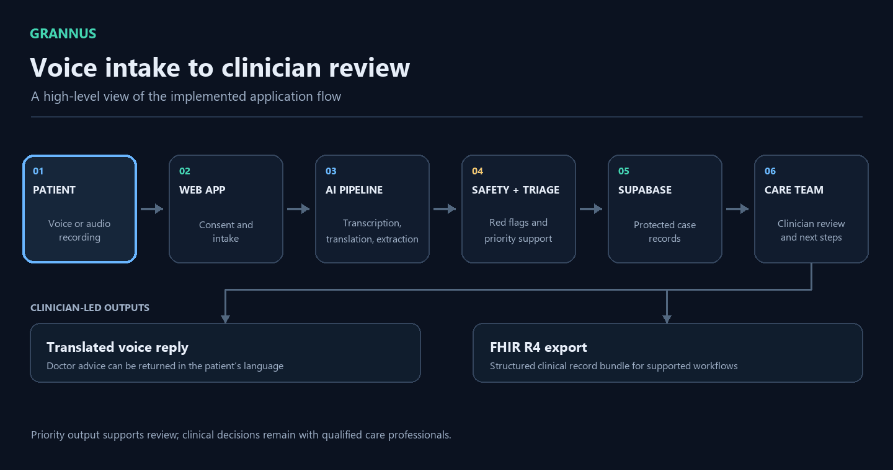
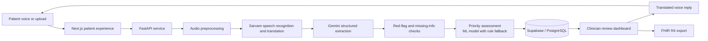

# Grannus

**Voice first care navigation for rural health teams.** Grannus turns a patient's spoken concern into a structured, multilingual intake that helps a clinician review urgency and decide what to do next.

> Grannus supports intake and triage workflows; it does not diagnose or replace a qualified clinician. The published evaluation is based on synthetic cases, not real patient outcomes or clinical validation.

[](https://github.com/lithishkanna/Grannus/actions/workflows/ci.yml)
[](LICENSE)

## How it works

Patients can speak or upload an audio recording. Grannus transcribes and translates the intake, extracts structured information, checks for safety flags, and prepares a priority assessment for clinician review. Clinicians can review the case, respond with a translated voice message, and export a FHIR bundle.



The animated diagram is a high-level view of the repository's implemented flow. Priority decisions combine deterministic safety rules with an ML model when available and a rule-based fallback; acoustic indicators are advisory only.

## What’s in the project

- **Voice intake:** audio recording and upload with multilingual consent and transcription.
- **Structured summaries:** speech is translated and organized into symptoms, history, and follow-up questions for review.
- **Safety and priority support:** red-flag screening and a HIGH / MEDIUM / LOW assessment, with explainable reasons and fallback behavior.
- **Clinician workflow:** consultation queue, case review, priority actions, referral information, and translated voice replies.
- **Interoperability:** FHIR R4 bundle export for supported records.
- **Privacy and operations:** role-aware access, consent and retention controls, health/readiness endpoints, and Supabase-backed persistence.

## Architecture



## Technology

| Area | Tools |
| --- | --- |
| Web application | Next.js 16, React 19, TypeScript, Tailwind CSS |
| API | Python 3.12, FastAPI, Pydantic |
| Speech and language | Sarvam AI Saaras; Google Gemini |
| Audio and triage | NumPy, SciPy, noisereduce, scikit-learn |
| Persistence | Supabase (PostgreSQL) |
| Local orchestration | Docker Compose |

## Run locally

### Requirements

- Python 3.10 or newer (CI uses Python 3.12)
- Node.js 20 or newer and npm
- A Supabase project, Sarvam API key, and Gemini API key for the full workflow

### 1. Configure the backend

```bash
cd backend
python -m venv .venv
# macOS/Linux
source .venv/bin/activate
# Windows PowerShell: .venv\Scripts\Activate.ps1
pip install -r requirements.txt
```

Copy `backend/.env.example` to `backend/.env` and set the required values. At minimum, configure `SARVAM_API_KEY`, `GEMINI_API_KEY`, `SUPABASE_URL`, `SUPABASE_ANON_KEY`, `SUPABASE_SERVICE_ROLE_KEY`, `DEFAULT_HOSPITAL_ID`, `JWT_SECRET_KEY`, and `PHI_ENCRYPTION_KEY`. Use strong, private secrets; do not commit `.env` files.

Start the API from the `backend` directory:

```bash
uvicorn app.main:app --reload --port 8000
```

The API health endpoint is `http://localhost:8000/health`; interactive API documentation is at `http://localhost:8000/docs`.

### 2. Configure and start the frontend

In another terminal:

```bash
cd frontend
npm install
```

Copy `frontend/.env.example` to `frontend/.env.local`. Set `NEXT_PUBLIC_API_URL` (normally `http://localhost:8000`) and the public Supabase URL and anon key, then run:

```bash
npm run dev
```

Open `http://localhost:3000`.

### Docker Compose

The root `docker-compose.yml` runs both services. Set the required deployment variables documented in the Compose file and your environment before starting:

```bash
docker compose up --build
```

## Evaluation and project status

The repository includes a [synthetic clinical evaluation report](CLINICAL_VALIDATION_REPORT.md), [deployment guide](PILOT_DEPLOYMENT_GUIDE.md), and [regulatory evidence inventory](REGULATORY_AND_COMPLIANCE.md). The evaluation uses generated scenarios and is useful for engineering checks; it does not establish clinical effectiveness, regulatory approval, or readiness for unsupervised use. A qualified clinical and regulatory review is required before real-world deployment.

See the [improvement plan](GRANNUS_IMPROVEMENT_PLAN.md) for known work and next steps. CI runs backend validation, a synthetic safety gate, and a frontend build on pushes and pull requests to `main`.

## Safety and privacy

- Grannus is decision support for trained health workers and clinicians, not a diagnostic service.
- Clinicians must make and document care decisions. Acoustic biomarkers are experimental and advisory; they do not independently trigger emergency decisions.
- For an emergency, contact local emergency services or go to the nearest emergency department. In India, call **112** or **108** where available.
- Configure consent, secrets, encryption, retention, access controls, and operational procedures for your deployment. Review [regulatory and compliance notes](REGULATORY_AND_COMPLIANCE.md) before handling real patient data.

## Contributing

Issues and pull requests are welcome. Please include the motivation, the affected workflow, and how you checked the change. Never include real patient data, credentials, or other secrets in issues, commits, or screenshots.

## License

Grannus is released under the [MIT License](LICENSE).
